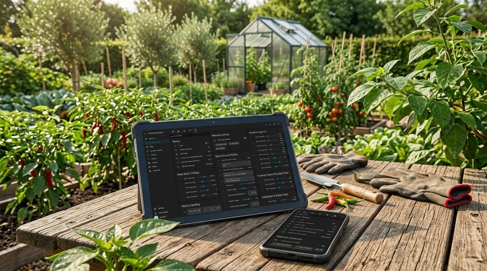
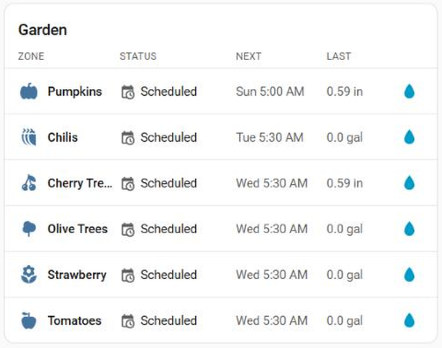
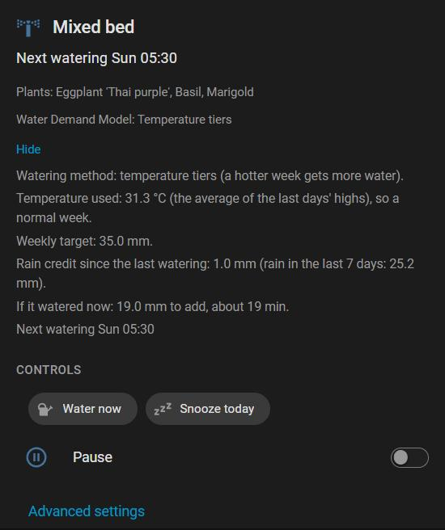
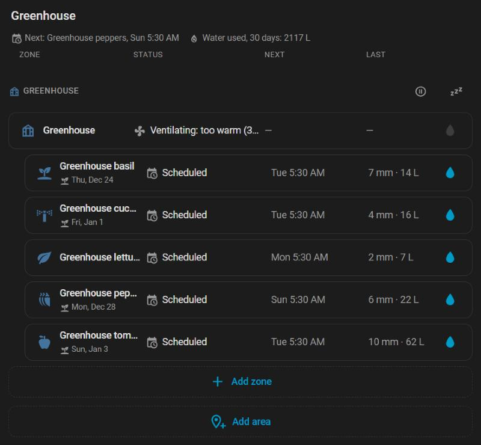
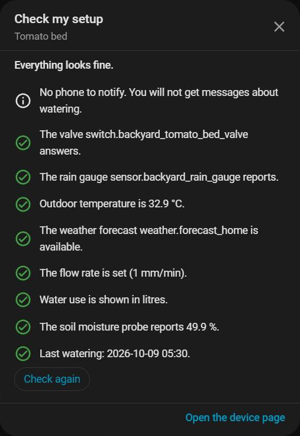

# ZoneFlow Irrigation

**ZoneFlow turns Home Assistant into the irrigation controller.** Use the valves, pumps, sensors and weather hardware you already have — from simple Zigbee relays to more advanced flow and soil sensors.

Full documentation: **[zoneflowirrigation.com](https://zoneflowirrigation.com/)**

**Try it first: [live demo with a guided tour](https://zoneflowirrigation.com/demo)**. A simulated garden you can click through in your browser, no install needed.

ZoneFlow works out when and how much each part of your garden needs water, from the plant, the soil, the weather and the rain, then runs the valve and tells you in plain words what it did and why. It also controls the climate of a greenhouse or indoor grow space. Only a valve switch is required; every sensor is optional and each one adds a capability.

## What it can do

- **Waters by need.** A light routine watering and an occasional deep soak per zone, from temperature tiers or an evapotranspiration curve, adjusted for the plant, soil, slope and mulch.
- **Uses the rain.** Rain credit from a rain gauge or a weather station (Ecowitt, Ambient Weather, Tempest, Davis and others), rain you enter by hand, a pause after heavy rain, a forecast skip and a frost guard.
- **Says why.** A plain-language status for every zone ("Skipped: the soil is wet (72%)"), phone notifications and a weekly summary.
- **Greenhouse and indoor zones.** Fans, vents, misters and a heater from an inside sensor, with several crops under one greenhouse.
- **Areas and plants.** Group zones into the parts of your garden (Backyard, Front yard) that share a rain gauge, thermometer and phone, pause a whole area at once, and keep a history for each plant. Copy a bed's settings to a new one or save them as a preset.
- **Easy setup.** A "Check my setup" checklist, a guided flow-rate calibration, likely sensors suggested in setup, a Simple view, buttons on phone messages and fix buttons in Repairs.
- **Water use.** Litres and gallons per watering, for the last 30 days and for the year.
- **Safe by design.** Runtime caps, a stuck-valve watchdog, pump and flow checks and power-loss handling: a cycle always ends with the valve closed.
- **Easy to run.** Built-in dashboard cards and a ready-made dashboard, 19 languages, no YAML, and an optional AI-assisted setup.

## See it

<table>
<tr>
<td width="50%"> <b>Your whole garden at a glance</b>, grouped by area.</td>
<td width="50%"> <b>Says why.</b> The numbers behind the next watering, in plain words.</td>
</tr>
<tr>
<td width="50%"> <b>Greenhouses</b> with fans, vents and their own crops.</td>
<td width="50%"> <b>Check my setup:</b> a plain checklist, problems first.</td>
</tr>
</table>

Or try it yourself in the [live demo](https://zoneflowirrigation.com/demo).

## Install

**One click:** 

Or by hand:

1. In HACS, search for **ZoneFlow Irrigation** and click **Download**. ZoneFlow is in the HACS default list, so no custom repository is needed.
2. Restart Home Assistant.
3. Settings → Devices & services → **Add integration** → **ZoneFlow Irrigation**, and follow the screens.

If HACS does not list it yet (its list refreshes now and then), add it by hand first: HACS → ⋮ → **Custom repositories** → `https://github.com/Dreamer41/ha-smart-irrigation`, type **Integration**.

Requires Home Assistant 2024.5 or newer. To install without HACS, copy `custom_components/zoneflow/` into `/config/custom_components/` and restart.

**First steps for a new zone:** [set the flow rate](docs/CALIBRATION.md) (the one number that must be right), press **Service Run 1 min** to check the valve, then let it run.

## Documentation

- **[zoneflowirrigation.com](https://zoneflowirrigation.com/)**: the full documentation.
- **[Live demo](https://zoneflowirrigation.com/demo)**: try ZoneFlow in your browser, with a guided tour.
- [Full guide](docs/GUIDE.md): what ZoneFlow does, sensors, dashboard, services, FAQ and the details behind this page.
- [Calibration](docs/CALIBRATION.md): flow rate, Zone Flow (litres) and the rain gauge.
- [Rain gauges and weather stations](docs/RAIN-GAUGES.md)
- [Areas, plants and easy setup](docs/AREAS-AND-PLANTS.md)
- [Greenhouse and indoor zones](docs/GREENHOUSE.md)
- [Weather Underground rain](docs/WEATHER-UNDERGROUND.md) (experimental)
- [AI-assisted setup](AI_SETUP.md): a guide an AI assistant follows to set ZoneFlow up for you.
- [Changelog](CHANGELOG.md) and [roadmap](ROADMAP.md).

## Help and feedback

Questions and bug reports: [GitHub issues](https://github.com/Dreamer41/ha-smart-irrigation/issues).

## License

[MIT](LICENSE).
